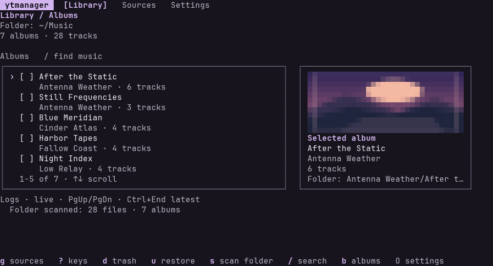
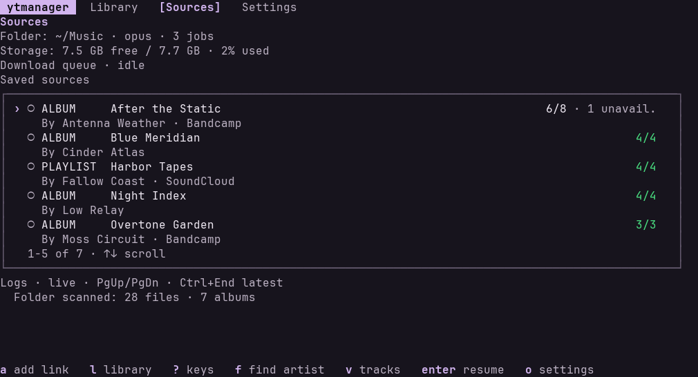
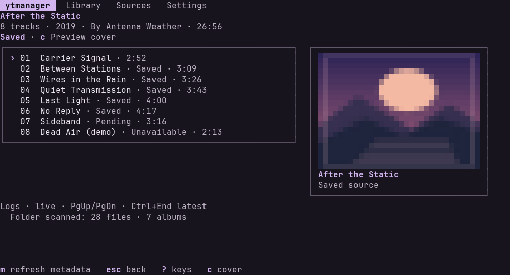
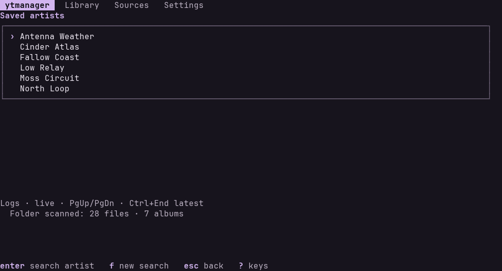
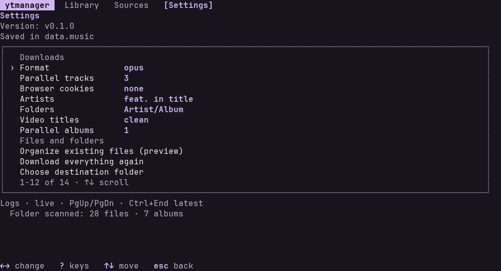

<p align="center">
  
</p>

<p align="center">
  <b>Your music library, organized and ready to play offline.</b>
</p>

<p align="center">
  
  
  
</p>

ytmanager downloads music from YouTube Music, SoundCloud, and Bandcamp. It keeps
audio, cover art, lyrics, and playlists together in a local folder or on a USB
drive or supported phone. Reopen a destination to browse what is already there or sync
its saved sources.

## Screenshots

Captured from the current terminal UI with a demo library.

**Library.** Browse local albums first. Wide terminals show the selected album's
artwork, track count, and folder alongside the list.



**Sources.** Add music links, check the download queue, and see which saved
sources are complete or still have tracks pending.



**Collection.** Review tracks in source order, with artwork and individual
download states.



**Artists.** Open the list of artists saved in the current library, or search
for an artist to explore releases.



**Settings.** Set the audio format and download concurrency, or preview changes
to existing files.



## Contents

- [Screenshots](#screenshots)
- [Features](#features)
- [Quick start](#quick-start)
- [Usage](#usage)
- [Browsing artists and collections](#browsing-artists-and-collections)
- [Managing your library](#managing-your-library)
- [Settings](#settings)
- [Troubleshooting](#troubleshooting)
- [Building from source](#building-from-source)
- [Adding a provider](#adding-a-provider)
- [License](#license)

## Features

- **Three music providers:** YouTube and YouTube Music tracks, albums, playlists,
  and mixes; SoundCloud tracks and playlists; Bandcamp tracks and albums.
- **Library first:** open a folder to browse its albums while ytmanager scans
  the files. The download queue stays in Sources, separate from local music.
- **Artist and collection previews:** browse releases and inspect tracks and
  artwork before downloading. Save source metadata on its own if you want to
  download later.
- **Tags, artwork, and lyrics:** YouTube URLs use confirmed YouTube Music audio
  rather than falling back to the video's audio. Downloads can include embedded
  artwork, an album `cover.jpg`, lyrics, and `.m3u8` playlists.
- **Reversible library tools:** compare duplicates, review unlisted tracks, and
  preview format or folder changes. Move files to trash and restore them later.
- **Resumable downloads:** pause, resume, or queue more links. Browser cookies
  support private YouTube playlists and Liked Music.

## Quick start

Download an archive for your platform from [GitHub Releases](https://github.com/racconrad/ytmanager/releases/latest),
extract it, and install the runtime tools below. Check your version with
`ytmanager --version` or in **Settings**.

Requirements: [yt-dlp](https://github.com/yt-dlp/yt-dlp#installation) (keep it up to date),
[ffmpeg](https://ffmpeg.org/download.html) with `ffprobe`, and [Go](https://go.dev/dl/) 1.25+
to build. Android phones on Linux also need gvfs, which most desktops include.

```sh
# Arch / CachyOS
sudo pacman -S yt-dlp ffmpeg go
# Debian / Ubuntu
sudo apt install ffmpeg golang && pipx install yt-dlp
# macOS
brew install yt-dlp ffmpeg go
```

```sh
git clone https://github.com/racconrad/ytmanager.git
cd ytmanager
go build -o ytmanager .
./ytmanager
```

## Usage

```sh
ytmanager            # choose a destination on the start screen
ytmanager ~/Music    # open a folder directly
```

1. **Open a destination.** ytmanager starts in **Library** when you open a
   folder. The first scan runs in the background.
2. **Add a source.** Press `g` for **Sources**, then `a` and paste a supported
   music link. Confirm with `Enter` to queue it.
3. **Return to your music.** Press `l` in Sources to go back to Library. Use
   `s` in Sources to fetch new tracks, or `s` in Library to rescan local files
   without downloading.

| Screen | Keys |
|---|---|
| Devices | `↑↓` move · `Enter` open · `e` edit path · `r` refresh |
| Folders | `→` open · `←` up · `n` new folder · `u` use this folder · `Esc` back |
| Library | `g` Sources · `/` search · `b` toggle albums/tracks · `s` rescan · `F` explore artist · `O` Settings · `c` change folder · `?` help |
| Sources | `a` add · `Enter` resume · `s` sync · `f` find artists · `v` view tracks · `l` Library · `o` Settings · `n` unavailable |
| Settings | `↑↓` move · `←→` change · `Enter` run action · `Esc` back |

In Sources, `Space` marks sources for sync, `p` pauses the queue, and `x`
cancels the current run. Removing a source with `d` keeps its audio.

### Scripts and cron

```sh
ytmanager add    ~/Music "$SOURCE_URL"  # set SOURCE_URL to a supported music link
ytmanager sync   ~/Music          # fetch new songs from every source
ytmanager resume ~/Music          # continue pending downloads
ytmanager repair ~/Music          # fix paths and rebuild playlists
```

Place flags before the command, for example `ytmanager -jobs 3 sync ~/Music`.
Other flags: `-format opus|m4a|mp3`, `-albums 1`, and `-cookies <browser>`.

### Output

```
Music/
├── data.music
├── Liked Music.m3u8
└── Artist/
    └── Album/
        ├── cover.jpg
        ├── 01.opus
        └── 01.lrc
```

## Browsing artists and collections

In **Sources**, press `f` to search YouTube Music by artist name, paste an
artist link from a supported provider, or submit an empty search to list saved
artists. In **Library**, press `F` on an album or track to search for its artist.

In an artist's discography, use `Tab` to switch between all releases, albums,
and singles or EPs. Press `v` to preview a release, `m` to save its metadata
without downloading audio, or `Space` to mark releases and `Enter` to queue them.
In **Sources**, `v` opens a saved collection in source order. Press `c` in an
artist or collection view to open the available cover in a browser.

## Settings

Press `O` in Library or `o` in Sources. Settings are saved in `~/.config/ytmanager/config.json`; the
format is saved per destination.

| Setting | Options |
|---|---|
| Format | `opus` (best quality) · `m4a` (Apple) · `mp3` (old car stereos) |
| Parallel tracks / albums | 1–8 songs and 1–4 albums at once |
| Browser cookies | Needed for private playlists and Liked Music |
| Artists | `feat. in title` (default) · `main only` · `all in artist` |
| Folders | `Artist/Album/01 - Song` (default) · `Artist/Song` · `Artist - Song` |
| Video titles | `clean` (default) · `as uploaded` |

Actions in the same panel preview organization and conversion of existing files, open library
help, or download everything again with the new settings. Changing **Format** alone affects
future downloads; use **Convert existing audio** to change local files.

## Managing your library

Library scans the selected destination when it opens, including music copied
there outside ytmanager. Press `s` to rescan just that folder.
Missing records stay visible. A complete scan schedules missing or invalid managed audio for
restoration on the next resume; missing tools and permission errors do not trigger redownloads.
Sync also reuses a unique, valid existing file with a matching embedded YouTube ID, including
renamed files. Ambiguous copies need review.

Use `b` to toggle albums and tracks, then `Enter` to open an album. `/` searches titles,
artists, albums, source names, codecs and paths. `space` marks a song or album; `a` marks all
visible results. Hidden search results are excluded from actions.

### Delete songs, albums and unlisted music

- `d` reviews marked files, or the highlighted song/album when nothing is marked. `enter`
  moves audio and unshared `.lrc` lyrics to `.ytmanager-trash/` inside the destination;
  `esc` cancels. External audio can be selected too.
- Album reviews keep songs shared with other sources by default. `h` includes them explicitly;
  doing so removes that music from every generated playlist that uses the same managed entry.
- On Sources, `D` opens the library filtered to that source's files. `d` on Sources only
  removes the source and its generated playlists, keeping the music.
- `o` shows audio outside **all saved sources** (including albums and single songs) and local
  `.m3u`/`.m3u8` playlists. Mark candidates and press `d`. Membership is checked again when
  applying cleanup. A failed or cancelled scan disables this filter until a complete rescan.
- The result report lists verified removals, files already absent and errors separately.
  Files changed since review are kept. Every mutation refreshes the physical inventory.
- `u` restores the latest deletion, conversion or folder change, including after a restart.
  Existing or modified files are never overwritten during restoration.
- `X` permanently removes journaled files from trash after confirmation. **Moving to trash
  does not free destination space**; empty it to reclaim space. Empty album folders are removed
  when no files remain.

Intentional managed deletions stay excluded from later syncs. Trash is excluded from scans,
duplicate detection, source recovery and cleanup. Custom playlists are preserved; generated
playlists and owned compatibility exports are refreshed when files change.

### Compare duplicates and formats

`f` groups possible duplicates. Identical SHA-256 values prove identical file bytes. Matching
artist/title tags also flag candidates across formats; different editions can share these tags,
and re-encoded copies do not have identical byte hashes. No music is deleted automatically.

Press `i` for the full path, source memberships, actual codec/container, duration, sample rate,
channel count, size and duplicate evidence. Bitrate is estimated from file size when the audio
stream does not report it. `!` filters missing, invalid, unreadable and mismatched-format files.
The scan inspects metadata; conversion additionally decodes the complete new audio to verify it.

### Convert audio and organize folders

Press `t`, choose **Format** and **Folders** with `←→`, and select **Preview changes**. Marked
visible files are used; without marks, all visible results are used. **keep** preserves that
setting. The preview lists old/new paths and blocks conflicting destinations before applying.
`esc` cancels; `enter` applies the reviewed plan. `x` cancels work, with completed changes reported.

| Target | Use | Local conversion |
|---|---|---|
| Opus | Compact music library | Opus at 160 kbps |
| M4A | Apple and AAC-compatible players | AAC at 256 kbps |
| MP3 | Older players and car stereos | LAME quality 0, variable bitrate |

Conversion preserves music tags, source identity, cover art and lyrics, verifies the output,
then keeps the original audio in trash. Re-encoding cannot restore quality lost in the source.
Files already using the selected codec and extension are left alone unless their folders change.
Folder-only changes move the existing audio without re-encoding it, using the same naming rules
as downloads: **Artist/Album**, **Artist**, or **flat**. Every change has a recovery journal.
External music remains locally managed after moving or converting it, without synthetic downloads.

Use Sources `r` to relink moved/renamed music by embedded source ID and rebuild playlists.
Ambiguous matches are reported and left for manual review. `?` in Library opens scrollable help.

## Troubleshooting

| Problem | Fix |
|---|---|
| Liked Music shows 0 tracks | Set *Browser cookies* to a browser logged in to YouTube. |
| Downloads suddenly fail | Update yt-dlp through the same method you used to install it. |
| Bandcamp extraction fails and yt-dlp reports an impersonation warning | Run `yt-dlp --list-impersonate-targets` to check whether your installation has an available target. |
| The phone does not appear | Unlock it, choose *File transfer*, press `r`. |
| A song is unavailable | Press `n` and paste another upload of it, or `r` to retry. |
| My player ignores the playlists | Press `e` to export `.m3u`, then rescan in the player. |

Android phones are supported on Linux only; on macOS and Windows download to a folder and copy it.

## Building from source

```sh
go build -o ytmanager .
go test ./...
```

See [CONTRIBUTING.md](CONTRIBUTING.md) for the project layout and how to add features.

## Adding a provider

A provider is a Go registry entry, not a runtime plugin. Start with a service
that your version of yt-dlp can list and download from. Check a track and, if
you plan to support collections, an album or playlist with:

```sh
yt-dlp --flat-playlist -J -- "$SOURCE_URL"
```

For example, add this entry to the `providers` slice in
[`internal/ytdlp/providers.go`](internal/ytdlp/providers.go). `music.example`
is a placeholder for a real extractor-backed host:

```go
{
    name:     "examplemusic",
    label:    "Example Music",
    external: true,
    matchHost: func(host string) bool {
        return host == "music.example"
    },
},
```

This registers the host and uses the shared external-track path. Use the
existing SoundCloud and Bandcamp entries as references if you need to validate
listings, distinguish albums from playlists, or normalize track URLs. Each
collection entry needs a track URL that matches the same provider. Add an
engine hook in [`internal/engine/provider.go`](internal/engine/provider.go)
only if you need provider-specific track resolution or metadata cleanup.
Artist profile links also need explicit classification in
[`internal/ytdlp/artist.go`](internal/ytdlp/artist.go).

Add tests for accepted URLs, rejected lookalike hosts, and parsing the
extractor's track and collection output. Run `go test ./...` before trying a
download to a temporary destination.

## License

[MIT](LICENSE) © MagusCat

## Disclaimer

Download only content you have permission to download and follow the source
service's terms. ytmanager is not affiliated with YouTube, SoundCloud, or Bandcamp.
